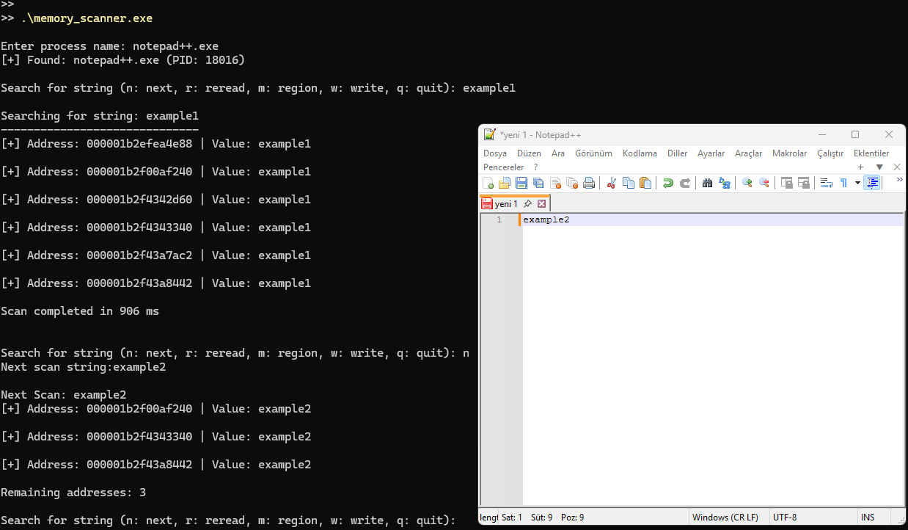
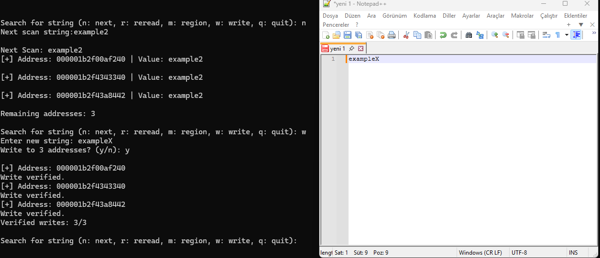

## Windows Memory Scanner

A simple Windows process memory scanner written in C using the Win32 API.

The program can search for strings in a running process, filter memory addresses with multiple scans, inspect memory regions, and modify memory contents.

 ### Compilation

Cross-compile on Linux using MinGW-w64:

```bash
x86_64-w64-mingw32-gcc -DPSAPI_VERSION=1 memory_scanner.c -o memory_scanner.exe -lpsapi
```

### Usage

Run memory_scanner.exe on Windows, enter a process name, and select a PID if multiple processes are found.

Available commands:

n — Next Scan

r — Re-read saved addresses

m — Show memory region information

w — Write a new string to saved addresses

q — Quit


### Example Usage

**Memory Scanning**



**Memory Modification**



### Note
This project was created for learning Windows process memory operations using the Win32 API. Use it only on processes you own or have permission to test.
